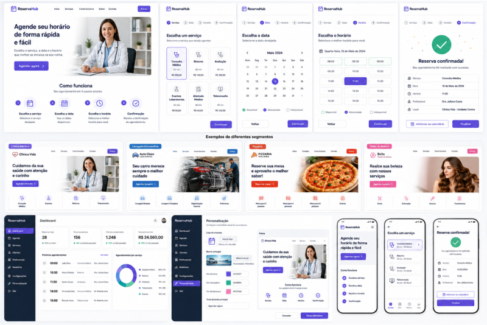

# ⚡ Projeto - ReservaHub

## 🚀 Sobre o projeto

Bem-vindo ao **ReservaHub**, uma plataforma moderna e dinâmica de agendamentos e reservas desenvolvida com **React, TypeScript e css**.

O projeto foi criado com foco em boas práticas de desenvolvimento Front-end, priorizando **performance, acessibilidade, semântica, organização do código, componentização e reutilização de componentes**.

A aplicação foi projetada para atender diferentes segmentos de negócio, permitindo que empresas personalizem sua identidade visual com **logo, banner, cores e informações próprias**.

O sistema pode ser utilizado por diferentes tipos de negócios, como:

- Consultórios médicos
- Clínicas
- Lavagens automotivas
- Pizzarias e restaurantes
- Salões de beleza
- Barbearias
- Academias
- Prestadores de serviços
- Outros segmentos que trabalham com reservas e agendamentos

A plataforma permite que clientes selecionem serviços, escolham datas e horários disponíveis e realizem reservas de forma simples e intuitiva.

---

# 📋 Pré-requisitos

Antes de executar o projeto, certifique-se de possuir instalado:

- **Node.js**
- **npm** (instalado juntamente com o Node.js)
- **Visual Studio Code**

---

# 🌍 Demonstração Online

Acesse a versão publicada da aplicação:

Em desenvolvimento.

---

# 🚀 Como executar o projeto

1. Clone o repositório

```bash
git clone https://github.com/Eds-FrontEnd/reserva-hub
```

2. Acesse a pasta

```bash
cd reserva-hub
```

3. Instale as dependências

```bash
npm install
```

---

## ▶️ Executando o projeto

Para iniciar o servidor de desenvolvimento:

```bash
npm run dev
```

O projeto será aberto em um servidor local.

Exemplo:

```text
http://localhost:5173/
```

---

### Observação

O projeto utiliza **React**, **TypeScript**, **Vite** e carregamento modular de componentes.

Por isso, o projeto deve ser executado através do servidor de desenvolvimento.

Utilize sempre:

```bash
npm run dev
```

---

# 🛠 Tecnologias utilizadas

- React
- TypeScript
- Vite
- React Router
- css
- CSS Variables
- React Hook Form
- Zod
- LocalStorage
- Fetch API
- Jest

---

# ✨ Recursos utilizados

O projeto foi desenvolvido utilizando diversos recursos modernos do ecossistema React.

- React
- TypeScript
- Componentização
- Hooks modernos
- React Router
- CSS
- CSS Variables
- Flexbox
- Grid Layout
- Componentes reutilizáveis
- Formulários controlados
- Validação de formulários
- LocalStorage
- Organização baseada em componentes
- Lazy Loading
- Responsividade
- Boas práticas de acessibilidade
- Navegação otimizada
- Arquitetura escalável

---

# 📅 Funcionalidades

- Cadastro de empresas
- Personalização da identidade visual
- Upload de logo
- Upload de banner
- Personalização de cores
- Cadastro de serviços
- Configuração de horários disponíveis
- Seleção de serviços
- Seleção de datas
- Seleção de horários
- Criação de reservas
- Confirmação de agendamento
- Gerenciamento de clientes
- Dashboard administrativo
- Visualização de agendamentos
- Interface responsiva
- Componentes reutilizáveis

---

# 🏢 Sistema Multi-Segmento

O **ReservaHub** foi desenvolvido para funcionar como uma plataforma genérica de reservas.

O sistema possui uma estrutura flexível que permite atender diferentes tipos de negócios.

Exemplo:

```text
RECURSO
↓
Pode ser:

👨‍⚕️ Médico
🚗 Box de lavagem
🍕 Mesa
💇 Profissional
🏋️ Equipamento
🏢 Sala
```

Os serviços também podem ser configurados de acordo com o segmento.

```text
SERVIÇO
↓
Pode ser:

Consulta
Lavagem
Reserva de mesa
Corte de cabelo
Treino
Aluguel de sala
```

Dessa forma, o mesmo sistema pode ser utilizado por diferentes empresas sem necessidade de alterar a estrutura principal da aplicação.

---

# 🎨 Personalização

Cada empresa poderá personalizar sua identidade visual.

Recursos previstos:

- Logo
- Banner
- Nome da empresa
- Cor principal
- Cor secundária
- Informações de contato
- Serviços disponíveis
- Horários de funcionamento

Exemplo:

```text
Empresa
│
├── Logo
├── Banner
├── Cor principal
├── Cor secundária
├── Serviços
├── Profissionais
└── Horários disponíveis
```

---

# 📅 Fluxo de Agendamento

O processo de reserva foi desenvolvido para ser simples e intuitivo.

```text
① Serviço
    ↓
② Data
    ↓
③ Horário
    ↓
④ Confirmação
```

Fluxo completo:

```text
Cliente
   ↓
Seleciona um serviço
   ↓
Escolhe uma data disponível
   ↓
Seleciona um horário
   ↓
Preenche seus dados
   ↓
Confirma a reserva
```

---

# 🔐 Área Administrativa

O sistema possui uma área administrativa para gerenciamento das reservas.

Funcionalidades previstas:

- Dashboard
- Agenda
- Serviços
- Clientes
- Profissionais
- Horários
- Relatórios
- Configurações
- Personalização

Estrutura:

```text
Dashboard
│
├── Agenda
├── Serviços
├── Clientes
├── Profissionais
├── Relatórios
├── Configurações
└── Personalização
```

---

# 🧩 Componentização

O projeto foi desenvolvido utilizando componentes reutilizáveis.

Principais componentes:

- Header
- Footer
- Sidebar
- Button
- Input
- Select
- Card
- ServiceCard
- Calendar
- TimeSlot
- BookingStepper
- Modal
- Toast
- Banner
- DashboardCard

A componentização permite reutilizar os mesmos elementos em diferentes partes do sistema.

---

# ♿ Acessibilidade

O projeto será desenvolvido seguindo boas práticas de acessibilidade.

Entre elas:

- HTML semântico
- Labels associadas aos inputs
- aria-label
- aria-live
- Navegação por teclado
- Focus visível
- Contraste adequado
- Estados visuais claros
- Botões acessíveis
- Imagens com textos alternativos
- Gerenciamento de foco em modais

---

# 📱 Responsividade

O layout será desenvolvido seguindo uma abordagem responsiva.

A aplicação será adaptada para:

- Desktop
- Notebook
- Tablet
- Smartphone

O sistema também contará com uma experiência otimizada para dispositivos móveis, facilitando a realização de reservas diretamente pelo celular.

---

# ⚙️ Organização do projeto

```text
reserva-hub
│
├── public
│   └── favicon
│
├── src
│   │
│   ├── assets
│   │   │
│   │   ├── images
│   │   │   ├── banners
│   │   │   ├── logos
│   │   │   ├── illustrations
│   │   │   └── references
│   │   │
│   │   └── icons
│   │
│   ├── components
│   │   │
│   │   ├── Button
│   │   ├── Card
│   │   ├── Calendar
│   │   ├── Header
│   │   ├── Footer
│   │   ├── Input
│   │   ├── Modal
│   │   ├── ServiceCard
│   │   ├── Sidebar
│   │   ├── TimeSlot
│   │   └── BookingStepper
│   │
│   ├── pages
│   │   │
│   │   ├── Home
│   │   ├── Booking
│   │   ├── Confirmation
│   │   ├── Login
│   │   └── Admin
│   │
│   ├── layouts
│   │   ├── PublicLayout
│   │   └── AdminLayout
│   │
│   ├── hooks
│   │
│   ├── services
│   │
│   ├── contexts
│   │
│   ├── types
│   │
│   ├── utils
│   │
│   ├── constants
│   │
│   ├── styles
│   │   │
│   │   ├── abstracts
│   │   ├── base
│   │   ├── components
│   │   ├── themes
│   │   └── main.css
│   │
│   ├── tests
│   │
│   ├── App.tsx
│   └── main.tsx
│
├── index.html
├── package.json
├── tsconfig.json
├── vite.config.ts
├── README.md
└── .gitignore
```

---

# 📁 Estrutura de Componentes

O projeto utiliza uma arquitetura baseada em componentes reutilizáveis.

Exemplo:

```text
components
│
├── Button
│   ├── Button.tsx
│   ├── Button.module.css
│   └── Button.test.tsx
│
├── Calendar
│   ├── Calendar.tsx
│   ├── Calendar.module.css
│   └── Calendar.test.tsx
│
├── ServiceCard
│   ├── ServiceCard.tsx
│   ├── ServiceCard.module.css
│   └── ServiceCard.test.tsx
│
└── TimeSlot
    ├── TimeSlot.tsx
    ├── TimeSlot.module.css
    └── TimeSlot.test.tsx
```

---

# 🧪 Testes

O projeto utilizará **Jest** para testes unitários dos componentes.

Exemplo de componentes testados:

- Button
- Input
- ServiceCard
- Calendar
- TimeSlot
- BookingStepper

Os testes terão como objetivo garantir o funcionamento correto dos principais componentes da aplicação.

---

# 🎨 Padrões utilizados

- Clean Code
- SOLID
- Componentização
- Separação de responsabilidades
- Código reutilizável
- Tipagem com TypeScript
- Componentes funcionais
- Hooks modernos
- css organizado
- Arquitetura escalável
- Boas práticas de acessibilidade
- HTML semântico
- Lazy Loading

---

# 🎯 Arquitetura do Sistema

O conceito principal do ReservaHub é possuir um único motor de reservas.

```text
ReservaHub
│
├── Empresa
│
├── Serviços
│
├── Recursos
│
├── Disponibilidade
│
├── Reservas
│
└── Personalização
```

Cada empresa poderá configurar seus próprios recursos.

Exemplo:

```text
Clínica
→ Médico

Lavagem Automotiva
→ Box de lavagem

Pizzaria
→ Mesa

Salão
→ Profissional
```

A lógica principal de reservas permanece a mesma.

---

# 🚫 .gitignore

O projeto possui arquivo `.gitignore` para evitar o versionamento de arquivos desnecessários.

Exemplo:

```gitignore
node_modules/
dist/
.vscode/
.env
.env.local
.DS_Store
```

---

# ✨ Demonstração

Abaixo está uma referência visual inicial do projeto.



---

# 👨‍💻 Autor

Projeto desenvolvido para fins de estudo e aprimoramento das habilidades em desenvolvimento Front-end utilizando **React**, **TypeScript** e **CSS**.

O projeto aplica conceitos modernos de **componentização, arquitetura escalável, responsividade, acessibilidade, testes automatizados, reutilização de componentes e boas práticas de desenvolvimento**.
